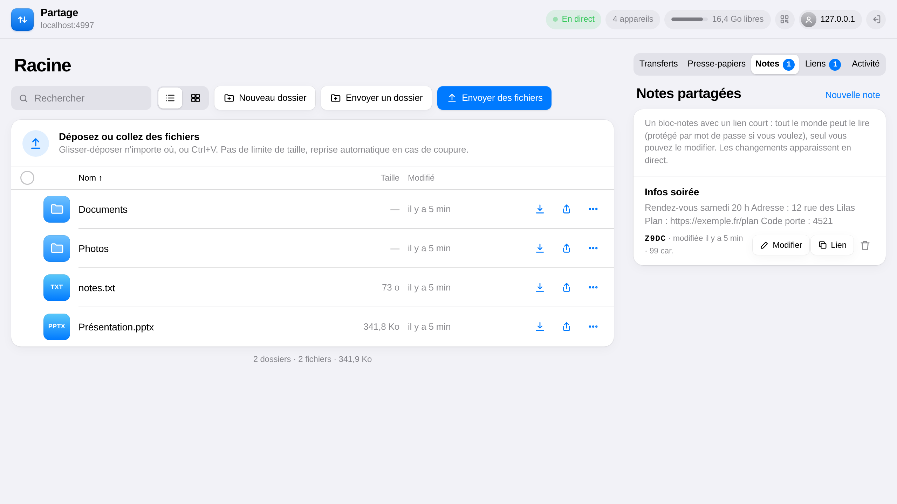
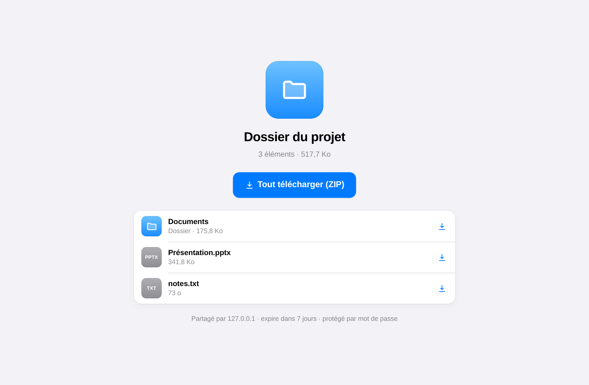
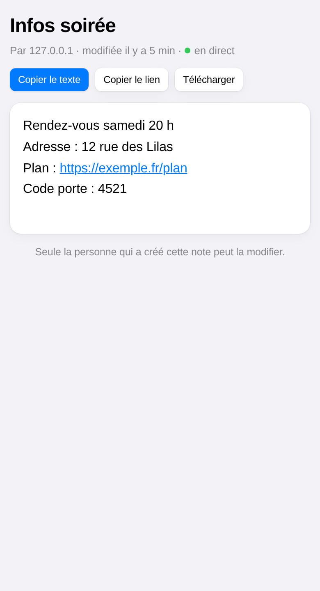
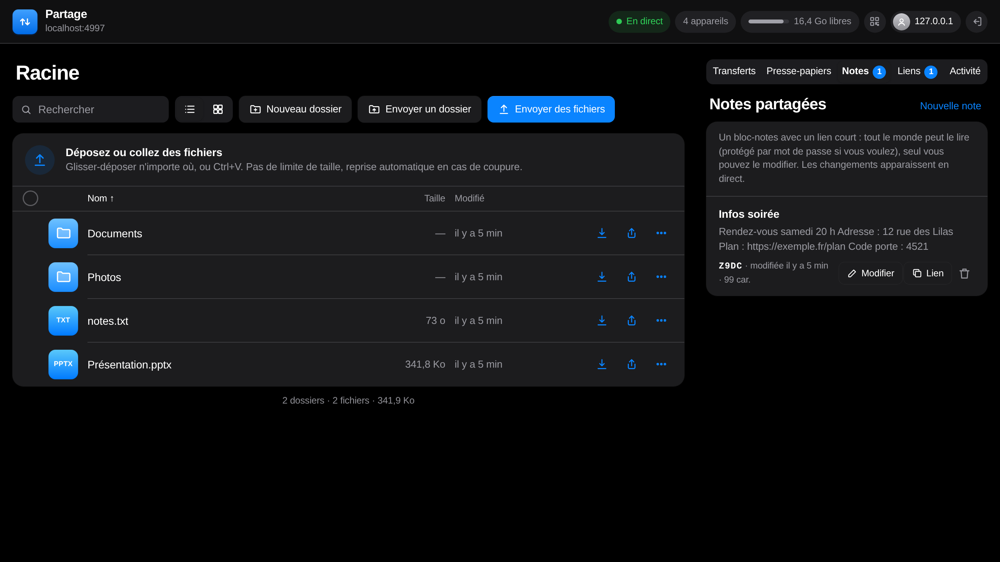

# Partage local

**Partage de fichiers en réseau local, rapide et sans dépendance.** Envoyez des fichiers de n'importe quelle taille depuis un navigateur, partagez-les par un lien court (`https://votre-serveur/AB3K`), échangez du texte et des notes en direct entre vos appareils.

Un seul programme Node.js, aucune dépendance, aucune base de données : installez-le sur un ordinateur, un Raspberry Pi, un Jetson ou un serveur, et ouvrez-le depuis tous les appareils du réseau.



## Fonctionnalités

- **Envoi sans limite de taille** : fichiers découpés en morceaux envoyés en parallèle, reprise automatique après une coupure, glisser-déposer de fichiers et de dossiers, collage (Ctrl+V) d'images et de captures.
- **Liens courts** de 4 caractères (`/AB3K`) pour un ou **plusieurs fichiers** ou dossiers : page de téléchargement élément par élément ou en ZIP, expiration, nombre de téléchargements limité, **mot de passe facultatif**.
- **Notes partagées** : un bloc-notes avec un lien court, lisible par tous (ou protégé par mot de passe), **modifiable uniquement par la personne qui l'a créé**, mis à jour en direct chez les lecteurs.
- **Presse-papiers partagé** entre tous les appareils connectés.
- **Temps réel** : progression des envois, activité, nouveaux fichiers, tout s'affiche instantanément sur tous les écrans.
- Aperçus (images, vidéos, sons, PDF, texte), vue en grille, sélection multiple, téléchargement de dossiers en ZIP (streaming, ZIP64), QR codes.
- **HTTPS** avec une autorité de certification locale générée automatiquement, HTTP/2, redirection HTTP → HTTPS sur le même port.
- Interface soignée, claire et sombre, pensée aussi pour le téléphone.
- Fonctionne sous **Linux, Windows et macOS**.

| Lien de partage | Note sur téléphone | Mode sombre |
|---|---|---|
|  |  |  |

## Installation

Il faut **Node.js 20 ou plus récent** ([nodejs.org](https://nodejs.org)) et `git`.

### Linux et macOS

```bash
git clone https://github.com/aryan09876/partage-local.git
cd partage-local
./partage install
```

### Windows

Ouvrez un terminal **en tant qu'administrateur** (clic droit sur « Terminal » ou « PowerShell » → Exécuter en tant qu'administrateur) :

```powershell
git clone https://github.com/aryan09876/partage-local.git
cd partage-local
.\partage install
```

L'installation pose quelques questions (avec des valeurs par défaut) : **port**, **qui peut accéder** (cette machine, le réseau local ou tout le réseau), **HTTPS**, **mot de passe**, **dossier de stockage**. Elle installe ensuite un service qui démarre avec la machine et redémarre tout seul en cas de problème (systemd sous Linux, tâche planifiée sous Windows, launchd sous macOS), et ouvre le port dans le pare-feu (ufw, firewalld ou pare-feu Windows) uniquement pour le réseau choisi.

Installation sans question (script, provisionnement) :

```bash
PARTAGE_PASSWORD='un mot de passe solide' ./partage install --yes --port 4892 --access lan --https auto
```

## Gestion

| Commande | Effet |
|---|---|
| `partage status` | état du service et adresses |
| `partage start` · `stop` · `restart` | démarrer, arrêter, redémarrer |
| `partage logs [-f]` | journaux (`-f` : en continu) |
| `partage config` | configuration actuelle |
| `partage set port 8080` | changer le port (pare-feu mis à jour, redémarrage) |
| `partage set access local` | `local` (cette machine), `lan` (réseau local + Tailscale), `all`, ou un sous-réseau `10.0.0.0/8` |
| `partage set https off` | HTTPS (`auto`) ou HTTP simple (`off`) |
| `partage set dir /data/partage` | dossier des fichiers partagés |
| `partage set public-url https://partage.exemple.fr` | adresse utilisée dans les liens courts |
| `partage set code-length 6` | longueur des codes courts (4 à 12) |
| `partage password` | changer le mot de passe (déconnecte toutes les sessions) |
| `partage certs [nom …]` | régénérer le certificat HTTPS (noms ou IP en plus) |
| `partage funnel on [8443]` | rendre Partage accessible depuis internet via [Tailscale Funnel](https://tailscale.com/kb/1223/funnel) |
| `partage backup [--with-files]` | archive de la configuration, des liens et des notes |
| `partage doctor` | diagnostic complet |
| `partage update` | mise à jour (`git pull`) et redémarrage |
| `partage uninstall [--purge]` | retirer le service (`--purge` : effacer aussi configuration, liens et notes) |

Sous Linux et macOS, les commandes qui en ont besoin demandent elles-mêmes `sudo`.

## Liens courts, mot de passe et notes

- Un lien court ressemble à `https://votre-serveur/AB3K`. L'alphabet évite les caractères ambigus (ni `0`/`O`, ni `1`/`I`/`L`) et la casse n'a pas d'importance : un code dicté au téléphone fonctionne toujours.
- Pour obtenir des liens du type `https://partage.exemple.fr/AB3K`, faites pointer votre nom de domaine vers le serveur (proxy inverse, tunnel Cloudflare, Tailscale Funnel…) puis `partage set public-url https://partage.exemple.fr`.
- Un code de 4 caractères offre environ 920 000 combinaisons : une adresse IP qui essaie trop de codes inexistants est bloquée 15 minutes. Pour un contenu sensible, **ajoutez un mot de passe** au lien (ou allongez les codes avec `code-length`).
- Une note reçoit un **lien de lecture** (à partager) et un **lien d'édition** secret. La clé d'édition est gardée dans le navigateur du créateur ; elle n'apparaît que dans le fragment de l'adresse (`#k=…`), qui n'est jamais envoyé au serveur dans l'URL.

## HTTPS

Avec `https auto`, Partage crée une **autorité de certification locale** et un certificat pour toutes les adresses de la machine (sans openssl, sous tous les systèmes). Le navigateur affiche un avertissement tant que vous n'avez pas installé `certs/ca.crt` sur l'appareil (lien « Installer le certificat de sécurité » sur la page de connexion). Si un certificat `certs/tailscale.crt` / `.key` est présent, il est servi automatiquement pour son nom `*.ts.net`.

## Configuration

`partage install` écrit `partage.env` à côté du programme (le serveur le lit au démarrage ; les variables d'environnement restent prioritaires) :

| Variable | Défaut | Rôle |
|---|---|---|
| `PORT` | `4892` | port HTTP/HTTPS |
| `HOST` | `0.0.0.0` | adresse d'écoute (`127.0.0.1` = cette machine seulement) |
| `SHARE_DIR` | `./storage` | fichiers partagés |
| `DATA_DIR` | `./data` | liens, notes, presse-papiers, historique |
| `AUTH_FILE` | `./auth.json` | empreinte du mot de passe |
| `CERT_DIR` | `./certs` | certificats HTTPS |
| `HTTPS` | `auto` | `auto` (si certificat présent) ou `off` |
| `PUBLIC_URL` | — | adresse publique des liens courts |
| `SHORT_CODE_LENGTH` | `4` | longueur des codes (4 à 12) |
| `CHUNK_MB` | `16` | taille des morceaux d'envoi |
| `TRUST_PROXY` | `on` | accepter `X-Forwarded-For` venant de `127.0.0.1` (proxy local) |
| `LOG_FILE` | — | journal dans un fichier (Windows, macOS) |

Lancement manuel, sans service : `node server.js` (mot de passe : `node server.js --set-password`).

## Sécurité

- Accès par mot de passe (scrypt), cookie `HttpOnly`/`Secure`, blocage progressif après 5 essais ratés.
- Chemins strictement confinés au dossier de stockage ; noms interdits sous Windows refusés ou corrigés.
- Mots de passe des liens et notes stockés en empreinte scrypt ; clé d'édition des notes stockée en empreinte SHA-256.
- Si Partage est exposé sur internet, utilisez un mot de passe solide et HTTPS.

Signaler une faille : ouvrez une *issue* sans détail exploitable, ou contactez le mainteneur en privé via GitHub.

## Développement

```bash
npm test          # tests de bout en bout (instance isolée, aucun effet sur votre installation)
node server.js    # lancer le serveur
```

| Fichier | Rôle |
|---|---|
| `server.js` | serveur HTTP/HTTPS (Node.js, aucune dépendance) |
| `manage.js` | gestionnaire multiplateforme (`partage …`) |
| `certs.js` | génération de certificats X.509 sans openssl |
| `public/` | interface (HTML, CSS, JavaScript sans framework) |
| `test/` | tests (`node --test`) |

Les contributions sont bienvenues : ouvrez une *issue* pour discuter d'un changement, puis une *pull request* avec les tests qui passent.

## English

**Partage local** is a fast, zero-dependency LAN file sharing server written in Node.js: unlimited-size resumable uploads, 4-character short links (`/AB3K`) for one or many files with optional password, expiry and download limits, live shared notes that only their creator can edit, a shared clipboard, and real-time updates on every screen. It runs on Linux, Windows and macOS: `git clone`, then `./partage install` (or `partage install` in an elevated Windows terminal). The interface is in French.

## Licence

[MIT](LICENSE)
